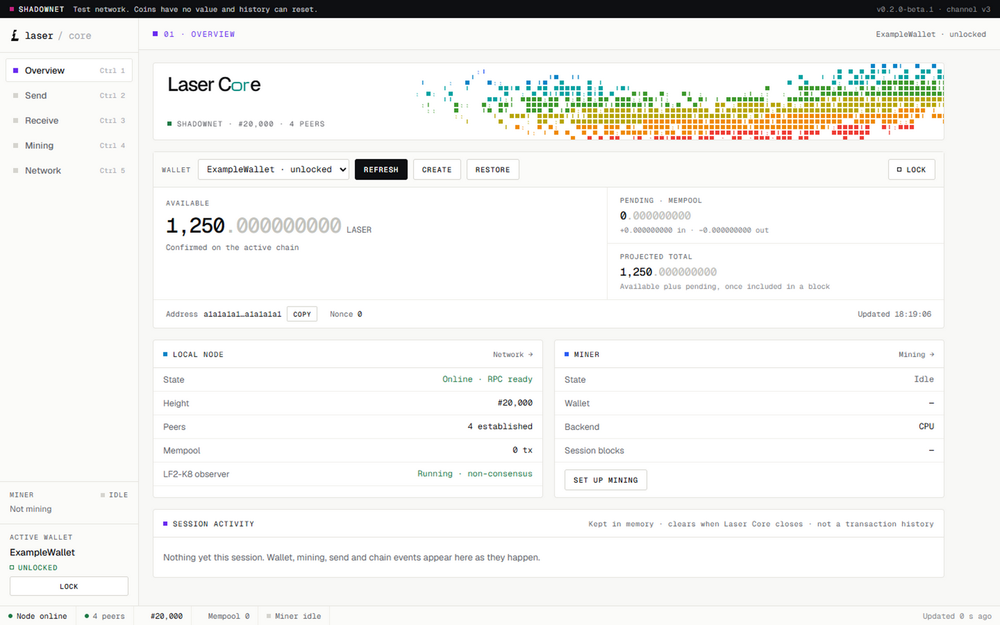

<p align="center">
  
</p>

<h1 align="center">Laser Core</h1>

<p align="center">
  A desktop full node, encrypted wallet, and miner for Laser Shadownet.
</p>

> [!WARNING]
> Laser Shadownet is an experimental test network. LASER mined here has no
> monetary value. Network history, software, and data formats may reset or
> change. Do not use this client to hold assets of value.

## Start mining

Laser Core currently supports Windows 10/11 x64. The portable client starts a
validating node automatically, connects to Shadownet peers, manages encrypted
wallets, and mines to the wallet you select.

### 1. Download and verify

1. Open the [Laser Core 0.2.0-beta.2 release](https://github.com/Laser-Chain/laser-core/releases/tag/v0.2.0-beta.2).
2. Download `Laser-Core-0.2.0-beta.2-portable-x64.exe` and `SHA256SUMS`.
3. In PowerShell, calculate the executable hash:

```powershell
Get-FileHash .\Laser-Core-*-portable-x64.exe -Algorithm SHA256
```

Confirm that the result exactly matches the executable entry in
`SHA256SUMS`. Current beta builds may be unsigned, so Windows can show a
SmartScreen warning. Only continue after verifying the checksum from this
repository's release page.

### 2. Run your node

Open the portable executable. Laser Core will:

- start the bundled `laserd` full node;
- connect to the Laser Shadownet bootstrap peer;
- validate and store the chain locally;
- start the non-consensus PhotonHash observer; and
- open the wallet and mining interface when RPC is ready.

The status bar shows peer count and chain height. Leave Laser Core running to
remain connected and continue validating Shadownet.

### 3. Create a wallet

1. Open **Overview**.
2. Select **Create**.
3. Choose a wallet name using letters, numbers, or underscores.
4. Enter and confirm a strong passphrase.
5. Store the passphrase somewhere safe—it cannot be recovered.

The encrypted wallet file is normally stored at:

```text
%APPDATA%\Laser Core\wallets\<wallet-name>.key
```

Back up that `.key` file while Laser Core is closed. Keep the backup and its
passphrase private. Use **Restore** to import an encrypted wallet backup.

### 4. Mine on Shadownet

The intensity controls described here are on `main`; the current tagged
`v0.2.0-beta.2` download predates them. See [release notes](RELEASE_NOTES.md).

1. Wait until the node is online and has at least one peer.
2. Create or open your wallet.
3. Open **Mining**. The active wallet should already be selected.
4. Choose the interval between mining cycles; `10` seconds is a sensible
   starting value.
5. Choose **Mining intensity**: Minimal (10%), Quiet (25%), Balanced (50%),
   High (75%), or Full (100%). Try Quiet when using the computer for other work.
6. Select **Start Mining**.

Intensity is saved on this computer and can be changed while mining; the new
choice applies to the next cycle. Lower settings use smaller CUDA batches and
insert rests between work batches. CPU fallback also rests between short work
periods. The percentage is a work/rest target, not a GPU power limit or a promise
of the same utilization reading in Task Manager. Full preserves the original
unthrottled behavior. Lower intensity reduces mining throughput. The cycle
interval remains a separate pause between completed blocks; neither setting
changes consensus, difficulty, or the network block target.

Minimal and Quiet also pause the optional LF2-K8 research observer, whose
matrix-bank preparation is separate from consensus mining. This avoids its
CPU bursts while leaving the validating node and miner running. Balanced,
High, and Full resume the observer. The choice is stored before startup so
low-intensity sessions do not launch the observer after a restart. Paused
research is shown explicitly in the app; no research measurements are
produced while it is paused. GPU clocks and fans remain controlled by the
device driver and firmware, so an intensity percentage is not a fan-speed cap.
Minimal keeps GPU mining enabled but works on one nonce with one CUDA thread
block. Quiet uses up to eight nonces and four CUDA thread blocks. Each block
walks the remaining matrix rows sequentially, then the host rests between
nonce batches. This limits simultaneous GPU work without extending GPU boost
time through many tiny launches. Successful batches also take their scheduled
rest. Windows uses a local high-resolution timer, with a normal sleep fallback.

The v3 CLI also accepts `laser node mine <wallet> [N] --intensity 10` together
with the usual `--rpc`, `--datadir`, and `--network` options. Older sandbox-v2
runtimes continue to support Full intensity only.

The Mining tab reports session blocks, rewards, solve time, errors, backend,
and lifetime totals for the loaded wallet. Select **Stop Mining** before
closing the client or switching wallets. Closing Laser Core also stops mining
and shuts the node down gracefully.

CPU mining works by default. When a compatible bundled CUDA helper and NVIDIA
GPU are available, the client can use CUDA acceleration while independently
checking every candidate with the CPU consensus implementation. Failure or
unavailability falls back to CPU automatically.

## Your local data

Default Windows locations are:

| Data | Location |
| --- | --- |
| Shadownet chain | `%APPDATA%\Laser Core\shadownet` |
| Encrypted wallets | `%APPDATA%\Laser Core\wallets` |
| Shadow evidence | `%APPDATA%\Laser Core\shadownet-evidence` |

Back up wallets before deleting application data. Never share wallet `.key`
files, passphrases, or RPC tokens.

## Node configuration

The portable client works without configuration. Operators can set these
environment variables before starting Laser Core:

| Variable | Purpose |
| --- | --- |
| `LASER_DATADIR` | Use a different chain-data directory |
| `LASER_PEERS` | Override bootstrap peers with a comma-separated list |
| `LASER_LISTEN` | Change the P2P bind endpoint |
| `LASER_ADVERTISE` | Advertise a reachable public P2P endpoint |
| `LASER_MINER_BACKEND` | Select `auto`, `cuda`, or `cpu` |
| `LASER_CUDA_DEVICE` | Select the CUDA device, default `0` |
| `LASER_CUDA_BATCH` | Set CUDA batch size from `1` to `65536` |

By default, the node makes outbound connections and binds P2P locally. Running
an inbound-reachable public node requires an appropriate `LASER_LISTEN`,
`LASER_ADVERTISE`, router/firewall configuration, and normal host hardening.

## Troubleshooting

- **No peers:** confirm the computer is online and that firewall or endpoint
  security is not blocking Laser Core.
- **Node stays offline:** close other Laser processes, restart the client, and
  read the startup error shown in the application.
- **Wallet will not open:** confirm the wallet name, backup file, and
  passphrase. Passphrases cannot be reset.
- **Mining stops:** reopen/unlock the wallet, check the node is online, and
  restart mining. Locking a wallet intentionally stops its mining session.
- **CUDA unavailable:** continue on CPU or update the supported NVIDIA driver;
  CUDA is optional and never changes consensus rules.

## Verify a release bundle

Every release bundle includes build identity, notices, release notes, an SPDX
SBOM, and strict SHA-256 checksums. From a source checkout, verify the full
bundle with:

```powershell
npm run verify:release -- -ReleaseDir <release-directory>
```

## Development

The 0.2.0-beta.2 release includes the redesigned native Electron interface, with
Overview, Send, Receive, Mining, and Network views. It uses the existing
sandboxed preload bridge and bundled assets. Photon amounts stay exact across
the native JSON and renderer boundary, and sending rechecks the unlocked
wallet and spendable balance before signing.



*Redesigned interface with example Shadownet wallet data.*

```powershell
npm ci
npm test
```

Edit the source files in [ui-src](ui-src/README.md), then regenerate the
checked-in renderer with Python 3 available:

```powershell
npm run build:ui
npm test
npm start
```

With the native runtimes staged, `npm run dist:redesign` produces a local
portable preview in `dist/redesign/`. Use the release workflow below when
preparing a distributable release.

Packaging also requires a compatible Laser node source checkout with the
mining-intensity CLI and RPC update. Rebuild the CLI, daemon, and optional CUDA
helper together; earlier v3 binaries do not support the new intensity argument.
Set
`LASER_SOURCE_DIR` to that checkout, build its Windows node binaries, prepare
the compatibility runtime, and build the client:

```powershell
$env:LASER_SOURCE_DIR = 'C:\path\to\laser'
npm run prepare:sandbox
npm run release:win
```

The v3 preparation step also stages the optimized explorer helper. Keep the
`laser-explorer` checkout beside the Laser source tree, or set
`LASER_EXPLORER_SOURCE_DIR` to its path.

The release workflow stages exact node binaries under the ignored `.runtime/`
directory, rejects version or hash mismatches, refuses dirty application
source, runs the full test suite, and assembles the final directory atomically.

See [RELEASE_NOTES.md](RELEASE_NOTES.md),
[SECURITY_AUDIT.md](SECURITY_AUDIT.md), [NOTICE.txt](NOTICE.txt), and
[SECURITY.md](SECURITY.md) before distributing or operating the beta.

## Explorer publisher

Every supported Windows x64 package includes the explorer publisher and the
native `lxe.exe` snapshot helper. Open **Settings → Explorer publisher** or the
**Network** screen to configure an HTTPS ingest endpoint and a token issued by
that explorer's operator. Save once to enable publishing on subsequent starts.
Publishing requires an authorized token; public distributions contain no shared
server credential. A fresh installation shows **Not configured**.

The Network screen shows export/upload state, the last successfully delivered
height and time, and errors. These are separate from local mining and node
height. A full-chain export can take about a minute on larger Shadownet stores;
upload completion is not instantaneous. Failed exports/uploads retry, uploads
time out after 30 seconds, and redirects are rejected. Shutdown and disabling
cancel pending publisher work. Publishing resumes when the local node recovers.

Settings live in `explorer-publisher.json` under Electron's user data directory
(`%APPDATA%/laser-core` on Windows). Tokens use Electron `safeStorage` encryption
for the operating system account, never renderer localStorage. Portable extraction
paths are resolved afresh each launch. Moving settings to another account or
computer requires re-entering the token. Changing the endpoint also requires a
new token. **Disable publishing** removes the saved credential and stays disabled
across restarts. Saving settings applies them immediately without restarting mining.

On the first run without saved settings, Core imports an existing complete
`LASER_EXPLORER_URL` / `LASER_EXPLORER_TOKEN` pair or the legacy
`explorer-publish.json` file. `LASER_EXPLORER_CONFIG` can identify that legacy
file. Successful import saves encrypted credentials; later launches use the saved
settings even when those environment variables are absent. Original operator
files are not deleted automatically. Remove obsolete plaintext configuration
after checking the saved setup. `LXE_BIN` remains a development helper override;
source launches otherwise use `.runtime/explorer/lxe.exe`. The upload interval
defaults to 3 seconds **after** export/upload completes (legacy `interval_ms` or
`LASER_EXPLORER_INTERVAL_MS`, clamped to 3–600 seconds). Unchanged successfully
delivered tips are not exported or uploaded again: the publisher first reads the
node's scoped, loopback STATUS endpoint. Independent thirty-second heartbeats
confirm the same indexed tip without claiming that a new block was mined.
If the explorer reports an authoritative server index, desktop publishing stops
and displays **Managed by server**. Node, wallet and mining operation remain
independent. Settings are bound to the selected network.

All electron-builder targets, including `dist:win`, `dist:redesign` and the
release workflow, run shared before/after packaging checks. They reject missing,
wrong-architecture, or changed helpers; missing publisher modules; and accidentally
packaged configuration files. `prepare:v3` stages the helper with its SHA-256
identity, the packaged resources include that identity, and release `BUILDINFO.txt`
records `explorer_helper_sha256`. Restage old runtimes before building this version.
The current native distribution is Windows x64; other OS/architecture targets
fail with an explicit unsupported-runtime error rather than shipping Windows
binaries as if they were compatible.

## License status

No project-wide license grant has been finalized. The source and package are
currently marked `UNLICENSED`; bundled components retain the terms listed in
[NOTICE.txt](NOTICE.txt).
